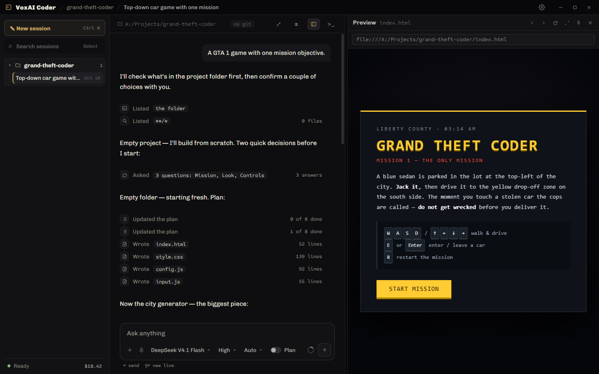
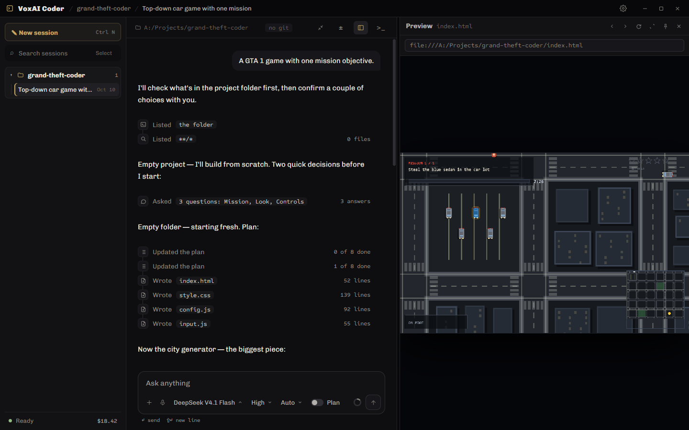
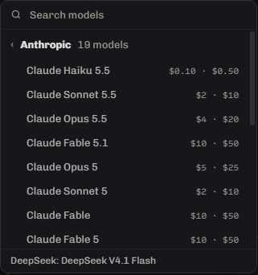
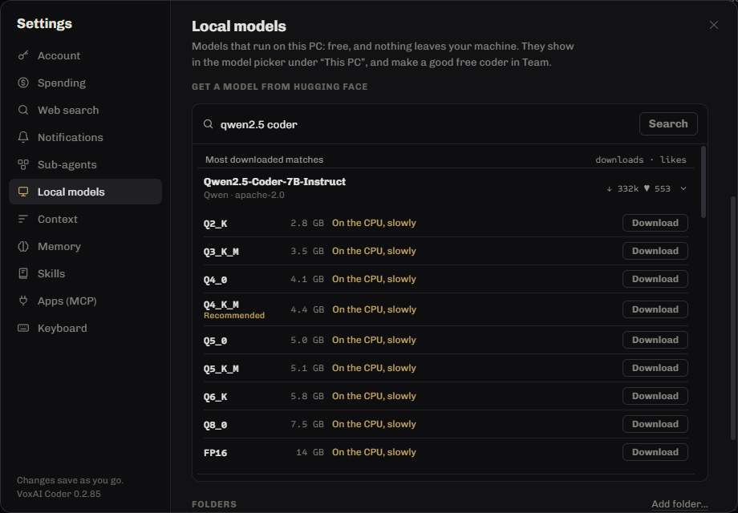
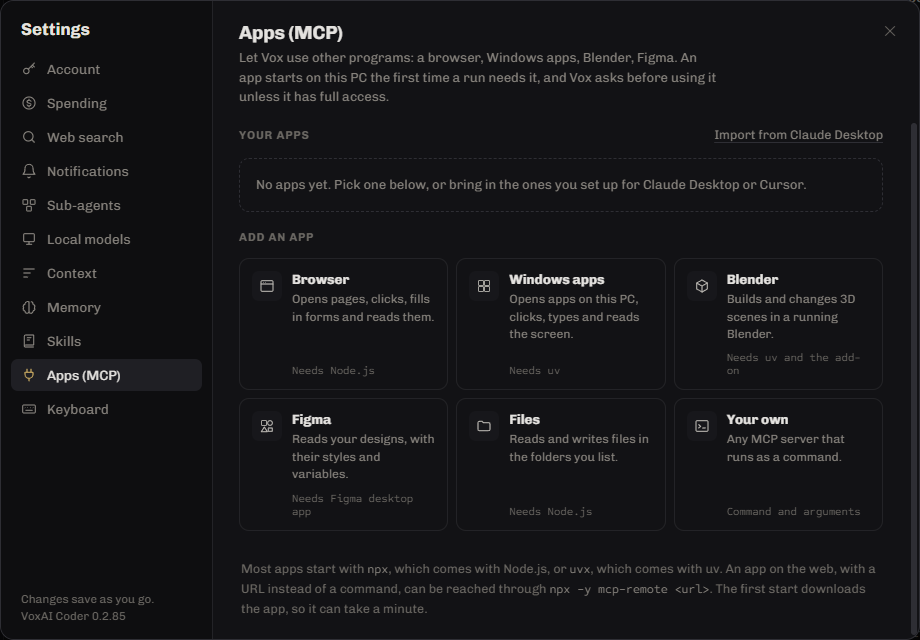
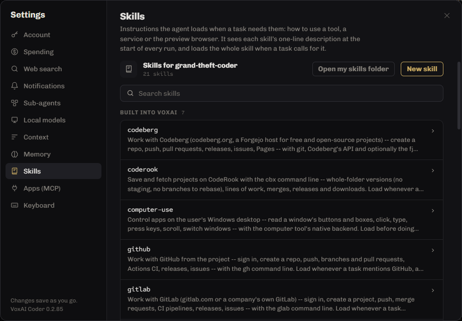
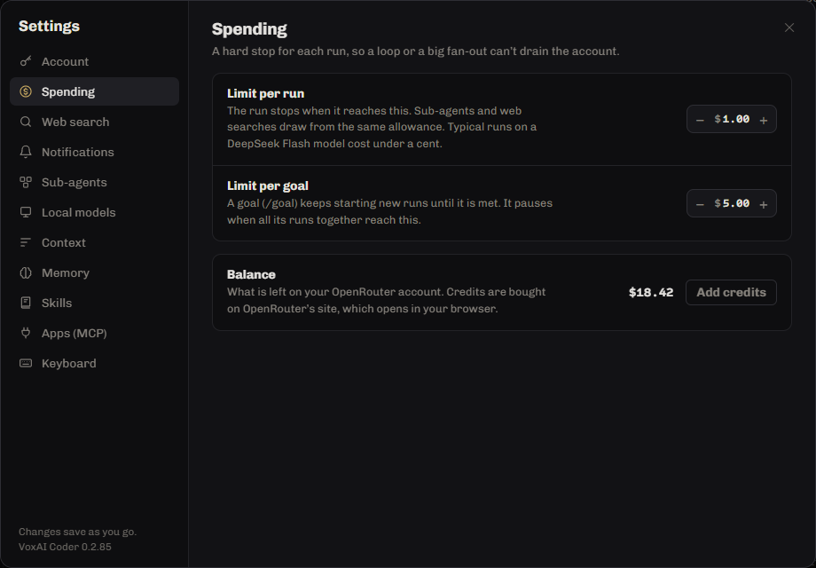
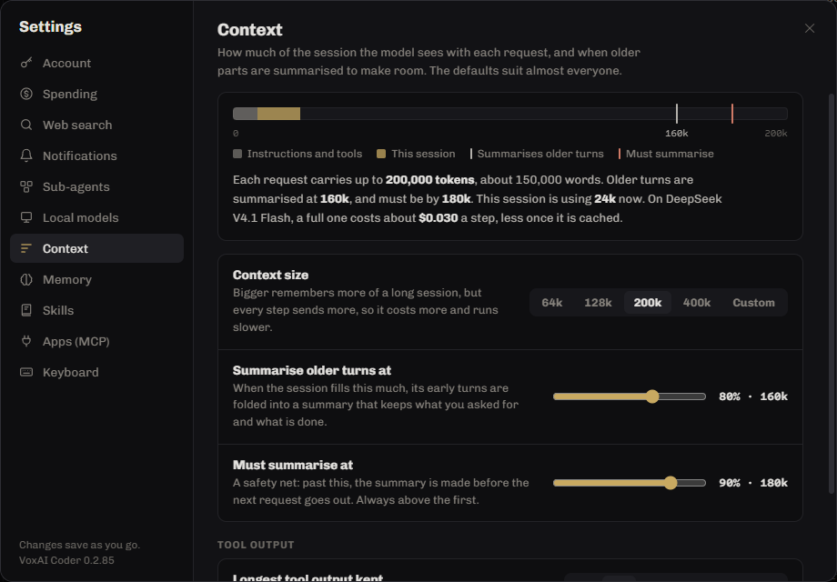

<div align="center">

```
██╗   ██╗ ██████╗ ██╗  ██╗ █████╗ ██╗    ██████╗ ██████╗ ██████╗ ███████╗██████╗
██║   ██║██╔═══██╗╚██╗██╔╝██╔══██╗██║   ██╔════╝██╔═══██╗██╔══██╗██╔════╝██╔══██╗
██║   ██║██║   ██║ ╚███╔╝ ███████║██║   ██║     ██║   ██║██║  ██║█████╗  ██████╔╝
╚██╗ ██╔╝██║   ██║ ██╔██╗ ██╔══██║██║   ██║     ██║   ██║██║  ██║██╔══╝  ██╔══██╗
 ╚████╔╝ ╚██████╔╝██╔╝ ██╗██║  ██║██║   ╚██████╗╚██████╔╝██████╔╝███████╗██║  ██║
  ╚═══╝   ╚═════╝ ╚═╝  ╚═╝╚═╝  ╚═╝╚═╝    ╚═════╝ ╚═════╝ ╚═════╝ ╚══════╝╚═╝  ╚═╝
```

**A desktop coding agent for Windows and Linux.**<br>
Any model on OpenRouter, or one running on your own PC. You pay only for what you use.

`[ v0.2.85 ]`  `[ Windows · Linux ]`  `[ MIT ]`

[Download](#-download) · [What it does](#-what-it-does) · [Build from source](#-build-from-source) · [Layout](#-layout)

</div>



```
 ┌──────────┐   ask    ┌──────────────────┐   any model    ┌──────────────────────┐
 │   you    │ ───────▶ │    agent loop    │ ─────────────▶ │ OpenRouter  or  your │
 └──────────┘          │  read · edit ·   │ ◀───────────── │ own PC (llama.cpp)   │
      ▲                │  run · check     │   tool calls   └──────────────────────┘
      │    the result  └────────┬─────────┘
      └─────────────────────────┘   files · shell · preview · tests
```

You describe what you want. VoxAI Coder reads your project, edits files, runs commands,
checks its work in a browser and reports back. The agent loop is its own (Node, inside
Electron): no external agent binary and no subscription, just your
[OpenRouter](https://openrouter.ai) key or a local model.

---

## ▓▒░ Download

```
 ╔═══════════╦══════════════════════════════════════════════════════╗
 ║  Windows  ║  VoxAI-Coder-Setup-0.2.85.exe   (installer, 115 MB)  ║
 ║           ║  VoxAI-Coder-0.2.85-portable.exe   (no install)      ║
 ╠═══════════╬══════════════════════════════════════════════════════╣
 ║  Linux    ║  installer script + AppImage, when the Linux build   ║
 ║           ║  for the current version is out                      ║
 ╚═══════════╩══════════════════════════════════════════════════════╝
```

- **Windows:** [the installer from CodeRook](https://api.coderook.com/v1/public/projects/batty-251/voxai-coder-releases/updates/VoxAI-Coder-Setup-0.2.85.exe),
  or both files from [GitHub Releases](https://github.com/AlexC1991/VoxAI_Coder/releases).
- **Linux:** from the [releases project on CodeRook](https://coderook.com/batty-251/voxai-coder-releases).

The installed app keeps itself up to date. It checks for new versions when it opens,
downloads them in the background and offers to restart when one is ready. Updates come from
CodeRook and are installed only when their signature and checksum match. The portable exe
does not update itself.

### ── First run

```
 1 ▸ Settings ▸ Account     paste your OpenRouter key, Save
                            (a management key is optional: balance and adding credits)
 2 ▸ the chat bar           pick a model and a project folder
 3 ▸ type what you want     and send
```

Keys are kept in the system keychain (Electron `safeStorage`) and are sent only to
OpenRouter.

---

## ▓▒░ What it does

### ── Builds it, then checks it



- Reads, writes, edits and patches files, and searches the project. Shell commands run in a
  terminal panel you can watch.
- A **preview browser** beside the chat for web apps and games, and **computer use** for
  desktop apps.
- **Permission modes:** *Ask first*, *Edit files*, *Edit and test*, *Auto* (a safety check
  decides what needs asking) and *Full access*. Work stays inside the project folder.
- **Plan mode**, a running task list, and **Review changes**, then commit or open a pull
  request.

```
 /goal    keep working until a separate check agrees it is done
 /review  review the changes that are not committed yet
 /init    study the project and write AGENTS.md
 /rewind  undo the file changes from the last run
 /loop    run a task again every so often
```

### ── Any model, priced before you send



- Every model on OpenRouter, browsed by company, with prices shown before you pick one.
- **Team mode:** a stronger model plans and reviews, and a cheaper one writes the code.
- **Sub-agents** for side tasks, each with its own model.

### ── Models on your own PC



- Local models on Windows through llama.cpp (Vulkan). The engine downloads once and is
  checked against its published SHA-256.
- Search Hugging Face and download GGUF models inside the app; the downloads resume and are
  checked when they finish.

### ── Apps, skills and memory



- **MCP apps:** a browser, Windows apps, Blender, Figma, files or your own server. Add,
  test, switch on and off, or import the ones you set up for Claude Desktop or Cursor.
- **Skills**, built in (GitHub, GitLab, Codeberg, CodeRook, the preview browser and computer
  use) or your own.
- **Project memory** and `AGENTS.md`, so a new session starts knowing the project.



### ── Costs you can see, and fewer tokens spent



- The cost of each message and session, a usage history with sortable columns, a limit per
  run and per goal, and your balance with a button to add credits.
- Fewer tokens on every model:

```
 ▸ one fixed session prompt, so the provider's cache keeps hitting
 ▸ only the memory that matters to the request
 ▸ a project overview and the project's own commands, up front
 ▸ old tool output pruned in batches, without breaking the cache
 ▸ a stop when the model goes in circles
 ▸ a check before the agent says it is done
 ▸ duplicate tools left out of what the model is sent
```



---

## ▓▒░ Build from source

You need Node.js 20 or newer (developed on Node 24) and Windows or Linux.

```bash
cd voxai-coder
npm install
npm start        # run the app
npm test         # offline regression tests: no model calls, no credits
npm run dist     # Windows installer and portable exe in voxai-coder/release
```

The Linux build is `npm run dist:linux`; see [LINUX-BUILD.md](LINUX-BUILD.md). Working on
the code: [voxai-coder/README.md](voxai-coder/README.md).

---

## ▓▒░ Layout

```
VoxAI_Coder/
├── voxai-coder/            the app
│   ├── src/main/           Electron main: settings, keychain, sessions, updater,
│   │                       local engine, Hugging Face downloads
│   ├── src/backend/        agent loop, providers, tools, Team mode, cost tracking,
│   │                       prompt caching and pruning
│   ├── src/renderer/       the UI (a single index.html)
│   ├── src/preload/        the bridge between the UI and main (window.voxai)
│   ├── resources/          icons, built-in skills, the public update key
│   └── test/               regression tests
├── docs/screenshots/       the pictures on this page
└── benchmark/              runs against other agents
```

---

## ▓▒░ License

```
 MIT  ·  Copyright (c) 2026 Batty 251
```

[MIT](LICENSE): the code, the screenshots in `docs/screenshots` and everything else in this
repository. The balance in the screenshots is a sample.
